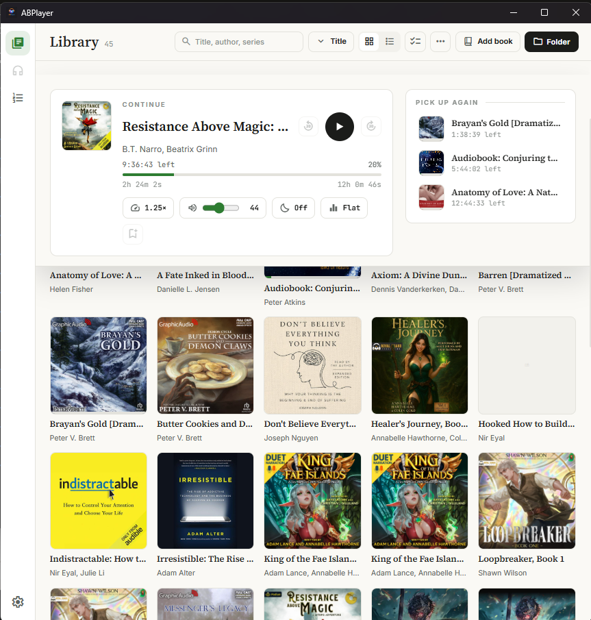
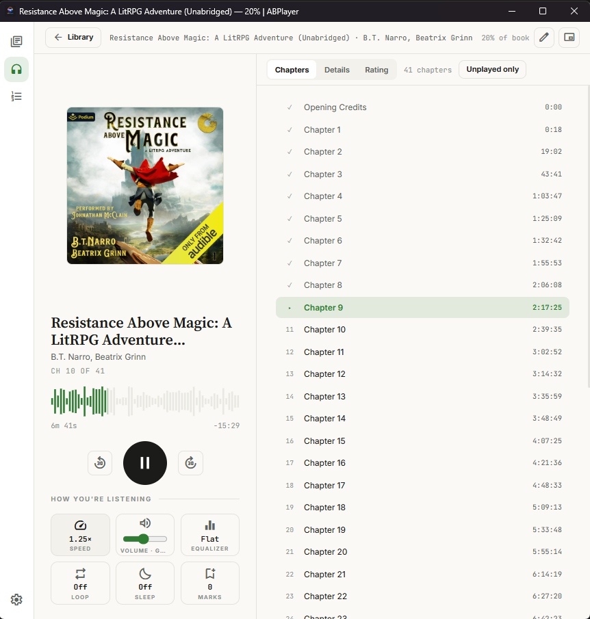
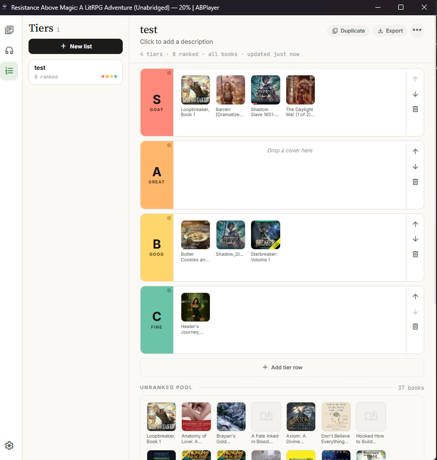

# ABPlayer

[](https://buymeacoffee.com/jhidalgo_dev)

A desktop audiobook player built with [Tauri v2](https://v2.tauri.app/) and [Svelte 5](https://svelte.dev/). Lightweight, fast, and fully offline.

<p align="center">
  
</p>

## Features

- **Three views** — Library, Player, and Tiers behind a narrow icon sidebar. One component vocabulary, a calm ink-on-paper palette with the accent reserved for progress and playback, a defined motion set, and a **Reduce motion** switch that also follows the OS setting. Everything scales in `rem`, so the font-size setting resizes the whole interface.
- **Library leads with what you were listening to** — a continue card with cover, transport, chapter, a draggable progress bar and your listening settings inline, beside a "Pick up again" panel of recent books. The row stays docked at the top while the grid scrolls, and rearranges itself as the window gets narrower. Minimum window is 540×440.
- **Player** — a split layout: cover, chapter-scoped waveform, transport and six control tiles (speed, volume, equalizer, loop, sleep, bookmarks) beside tabs for Chapters, Details and Rating. The listening column always fits the window height. Speed is picked from a menu (0.75×–3×).
- **Playback** — MP3, M4A, M4B, MP4, OGG, FLAC, WAV. Opening a part-read book continues where you left it; "Start over" is on the continue card. Large M4B files with the `moov` atom at end-of-file start within seconds, and a spinner (with an explanation after 800 ms) shows until audio begins.
- **Mini player** — a 360×104 always-on-top window: progress rail, cover, title, the chapter or track you are on, elapsed and total, and the transport. Click the elapsed time and type where you want to be — `1:23:45`, `23:45` or `1h 23m`. Drag it from anywhere that is not a control.
- **Media keys** — hardware play/pause and skip keys, and the transport in Windows' volume overlay, drive the player. Title, author, current chapter and cover appear there; previous/next step through chapters.
- **Chapters from anywhere** — QuickTime and Nero chapters in M4B/MP4, ID3v2 `CHAP` frames in MP3, and `.cue` or `.chapters.txt` sidecars next to files that carry none of their own. Multi-file books get one chapter per file.
- **Chapter-per-file books are one book** — a subfolder of audio files is one book, and loose chapter files in a library folder are folded together too: by album tag, or by file name once the numbering is removed ("My Book - 03", "Chapter 1…n"). Select any entries and **Combine** them into one book with your own title and playing order, or **Split** a book back into files; both survive rescans. A switch in Settings turns the automatic grouping off.
- **Covers** — embedded art, or a `cover.jpg` / `folder.png` / `front.*` (or the only image) in the book's folder. A book without one can be given a cover at any time.
- **Audio processing** — 3-band equalizer with presets (Flat, Voice Boost, Bass Reduce, Clarity, Podcast) plus up to twelve of your own, per-book volume gain, and speed, volume, mute and EQ remembered between launches.
- **Library** — folder scanning with background metadata enrichment, cover art on disk, search, sort and filter by status, genre, series, collections and tier. Sorting by series shows one shelf per series in reading order with the next unfinished book marked. A book you remove stays removed — later scans leave it out, and **Settings → Removed books** brings it back.
- **A page for every book** — open a book without starting it: progress and time left, description and metadata, your notes and favourite quotes, the files it is made of with their lengths, its chapters and your bookmarks.
- **Right-click a book** — play it, open its page, edit it, set its status in one click, tick the collections it belongs to, place it on a tier, give it a cover, split it back into files, or remove it. The same menu in the grid and in the list.
- **Tier ranking** — as many tier lists as you want ("Fantasy all-time", "2025 reads", …), each with its own rows, colours and rating axes. Every library book is already in the list's unranked pool: drag covers between tiers, right-click a cover to pick its tier, set it in the edit dialog, or rank straight from the library — a strip of tiers appears while you drag a cover. A book can sit in several lists at different tiers.
- **Metadata-only books** — log books you listened to elsewhere (Audible, library, physical) without the audio file. Source-aware fallback opens an Audible or WorldCat search.
- **Per-book ranking card** — tier picker, editable per-axis sliders, personal notes, favourite quotes.
- **Organisation** — bookmarks, collections with colour tags, series grouping, library export and import (tier lists, logged books and combined books included).
- **Bulk editing** — "Select books" opens an action bar: select all, shift-click a range, then set status, add to a collection (or create one on the spot), add or remove tags, place on a tier, combine, or remove. Dragging one selected book carries the whole selection onto a collection or tier.
- **Extras** — sleep timer, A-B repeat, waveform seek bar, listening statistics including time per collection, 6 colour themes, light/dark mode, font family presets (Editorial / Modern).
- **Keyboard shortcuts** — Space (play/pause), arrows (skip/volume), M (mute), Ctrl+F (search), Ctrl+Shift+P (global play/pause), Ctrl+Shift+M (open mini-player), and `?` for the full list.

## Screenshots

<p align="center">
  
</p>
<p align="center"><em>Library — the continue card and "Pick up again" docked above your books</em></p>

<p align="center">
  
</p>
<p align="center"><em>Player — cover, waveform and transport beside the chapter list</em></p>

<p align="center">
  
</p>
<p align="center"><em>Tiers — rank your books by dragging covers between rows</em></p>

## Downloads

See the [Releases](../../releases) page for:
- **Portable** — Single `.exe`, no installation required.
- **Installer** — Windows NSIS installer.

> **Note:** Windows Defender SmartScreen may show a warning because the app is not yet code-signed. This is normal for indie software. Click **"More info"** then **"Run anyway"** to proceed. The app is fully open-source — you can inspect the code or build it yourself.

---

## Architecture

### Overview

ABPlayer is a Tauri v2 desktop application with a Svelte 5 frontend and a Rust backend. All data stays local — no network calls, no accounts, no telemetry.

```
┌──────────────────────────────────────────────────────┐
│  Svelte 5 Frontend (WebView)                         │
│                                                      │
│  ┌─────────┐  ┌──────────┐  ┌────────┐  ┌────────┐  │
│  │ Library  │  │ Player   │  │ Tiers  │  │ Mini   │  │
│  │  View    │  │  View    │  │  View  │  │ Player │  │
│  └────┬─────┘  └────┬─────┘  └───┬────┘  └────┬───┘  │
│       │              │             │            │     │
│  ┌────┴──────────────┴─────────────┴────────────┴──┐ │
│  │           Svelte Stores (reactive state)         │ │
│  │  audioStore · libraryStore · positionStore      │ │
│  │  userdataStore · bookmarkStore · statisticsStore │ │
│  │  tierListStore · sleepTimerStore · mediaSession  │ │
│  └────────────────────┬─────────────────────────────┘ │
│                       │                              │
│          ┌────────────┴──────────────┐               │
│          │ @tauri-apps/plugin-store  │               │
│          │  (JSON key-value on disk) │               │
│          └────────────┬──────────────┘               │
├───────────────────────┼──────────────────────────────┤
│  Rust Backend         │                              │
│                       │                              │
│  ┌────────────────────┴────────────────────────────┐ │
│  │  Tauri Commands (IPC)                           │ │
│  │  read_audio_meta · audiostream:// protocol      │ │
│  └─────────────────────────────────────────────────┘ │
└──────────────────────────────────────────────────────┘
```

### Audio Pipeline

Audio playback uses a custom `audiostream://` protocol registered in Rust, which serves local audio files with proper CORS headers. This is necessary because the Web Audio API's `createMediaElementSource` requires CORS-compliant responses — the default Tauri asset protocol does not provide these.

```
audiostream://localhost/{encoded-file-path}
    │
    ▼
Rust handler (asynchronous, runs off the WebView2 main thread)
    ├── URL-decodes the file path (percent-encoding crate)
    ├── Canonicalizes the path (prevents directory traversal)
    ├── Reads the file with Range request support (HTTP 206)
    ├── Open-ended ranges serve up to 16 MB per response
    │   (so M4B files with the moov atom at EOF reach playback
    │   in a handful of round-trips instead of dozens)
    ├── Wraps the handler in catch_unwind so a panic can't leave
    │   the WebView2 request hanging
    ├── Sets CORS headers (Access-Control-Allow-Origin: *)
    ├── Sets Content-Type based on file extension
    └── Returns audio bytes with Cache-Control: immutable
```

On the frontend, the signal chain is:

```
HTMLAudioElement (src = audiostream://...)
    │
    ▼
MediaElementAudioSourceNode
    │
    ▼
BiquadFilterNode (lowshelf, 250 Hz)   ← Bass EQ
    │
    ▼
BiquadFilterNode (peaking, 1000 Hz)   ← Mid EQ
    │
    ▼
BiquadFilterNode (highshelf, 4000 Hz) ← Treble EQ
    │
    ▼
GainNode (per-book volume, -6 to +12 dB)
    │
    ▼
AudioContext.destination
```

All EQ parameter changes use `setTargetAtTime` for smooth transitions that prevent audio pops. EQ presets are app-wide and stored with the user preferences; per-book gain stays with the book.

### Media Keys

The player publishes itself through the browser's Media Session API: metadata (title, author, current chapter as the album line, cover), playback state, and a throttled position state. Chromium maps the session to Windows' System Media Transport Controls, so hardware keys and the volume-overlay transport work without any native plugin. Previous/next track actions step through chapters; "previous" restarts the current chapter when more than three seconds into it.

### Metadata & Chapter Extraction

All metadata is read in Rust through the `read_audio_meta` IPC command. Nothing is parsed in the WebView.

**Tags and duration — `lofty` crate**:
- Reads the file directly from disk (no WebView memory overhead).
- Extracts: title, artist, album, duration, cover art (as base64 data URL).
- Handles MP3 (ID3v2), M4A/M4B/MP4 (iTunes atoms), OGG (Vorbis comments), FLAC, WAV.

**MP4/M4B chapters** (custom atom parser):
- Parses the MP4 `moov` atom tree manually (lofty doesn't expose chapters).
- **QuickTime chapter tracks** (`tref` → `chap` reference → chapter text track) — resolves per-sample file offsets via the full `stsc` / `stco` / `co64` / `stsz` / `stts` tables, so files with many samples packed into a single chunk are handled correctly.
- **Nero `chpl` fallback** (`udta` → `chpl`) with a sanity gate that rejects results where timestamps exceed file duration by more than 20% (protects against stub atoms written by some re-muxers).
- Text samples decoded with UTF-8 / UTF-16 BE / UTF-16 LE / Latin-1 detection.
- All allocations capped at 16 MB to prevent OOM from malformed files.

**MP3 chapters** (custom ID3v2 parser):
- Walks ID3v2.3 and v2.4 tags, including extended headers and whole-tag or per-frame unsynchronisation.
- Reads `CHAP` frames and the `TIT2` sub-frame inside each for the title, in any of the four ID3 text encodings.

**Chapter sidecars**: a file with no chapters of its own takes them from a `.cue` sheet (`INDEX 01` at 75 frames per second) or a `.chapters.txt` (`hh:mm:ss.mmm Title` lines) next to it — `Book.cue`, `Book.chapters.txt`, `Book.m4b.cue` or `Book.m4b.chapters.txt`. Embedded chapters always win; the Details tab says when chapters came from a sidecar.

**Title fallback**: some encoders (Audible, iTunes) write the first chapter's name into the file's title atom. If the parsed title matches the first extracted chapter, the display title falls back to `album`.

### Library Indexing

The library is a list of `BookMeta` objects stored in `library.json` via Tauri's plugin-store.

**Scanning flow:**

1. User adds a folder → `readDir` recursively finds audio files.
2. **Grouping** — Books the user combined by hand claim their files first. `.m4b` files are otherwise always single-file books. A subfolder with several files is one multi-track book. Loose files directly inside a library folder are grouped by album tag, else by file name with its numbering removed (`utils/grouping.ts`); anything unmatched stays a single-file book. Folders and groups the user split are left as files, and anything the user removed from the library is left out altogether.
3. **Phase 1 (instant)** — Books are created with just file paths and folder-derived titles. The library renders immediately with placeholder data.
4. **Phase 2 (background enrichment)** — For each book, `extractMetadata` is called on the first track. Title, author, album, cover art, and duration are populated; a book with no embedded cover takes an image from its folder. Updates are batched (5 books per store update) to minimize reactive re-renders. Metadata-only (fileless) books are preserved across scans and skipped by the enrichment loop. Album tags are only known at this point, so grouping runs once more afterwards and any newly found book is assembled from the entries it replaces, without reading the files again.
5. **Cover migration** — Base64 cover art is saved to `$APPDATA/covers/` as JPEG files. The library store is updated with asset-protocol URLs. This runs once; subsequent loads skip migration.
6. **Persistence** — The enriched library (with asset URLs, not base64) is saved to `library.json`.

**File watching**: After the initial scan, a recursive file watcher monitors all library folders. New or changed files trigger a debounced rescan (2-second delay after the last change event).

**Removals stick**: the files stay on disk, so removing a book also records what it was made of in `library.json` (`hidden`) — a file path, or the folder of a subfolder book, so files added to that folder later stay out too. Every later scan skips them. Taking a folder out of the library forgets its entries, adding it back restores them, and Settings clears the list in one go.

### Grouped Books

A book made of files that do not simply share a subfolder is stored under a virtual path: `group:<id>` when the user combined it, `group:auto:<folder>::<label>` when the scanner matched it. The automatic key is derived from the folder and the shared album or file name, so it is the same on every scan and positions, ratings and tier placements stay attached. Combined books (`groups`) and split decisions (`splitKeys`) are kept in `library.json`; removing a combined book removes its definition, and a track whose file has gone drops out without destroying the book.

### Metadata-Only ("Fileless") Books

Books without a local audio file are stored as normal `BookMeta` entries with `fileless: true` and a sentinel `filePath = "fileless:<id>"`. This keeps every existing `filePath`-keyed store (userdata, positions, bookmarks, tier assignments) working unchanged. The player short-circuits playback for fileless books and — when the book is marked with an Audible or Library source — offers an "Open in {source}" button via `plugin-shell` that opens a search URL in the user's default browser.

### Tier Lists

Tier lists live in their own store (`tierlists.json`). Each list owns its own tiers, colors, default axes, and `assignments: Record<filePath, tierId>`. A book can be ranked in many lists with different tiers. One list is flagged as the **default** — it powers the tier badge on library covers and the "Your rating" card on the player detail. Covers move between tier rows and an unranked pool with pointer-event drag-and-drop (Tauri's native drop handler, kept on so folders can be dropped from Explorer, swallows in-page HTML5 drops), and a right-click menu on any cover picks its tier directly.

### Position & State Persistence

All app state is persisted via `@tauri-apps/plugin-store`, which writes JSON files to the OS app data directory (`%APPDATA%/com.abplayer.app/` on Windows).

| Store file | Contents |
|---|---|
| `library.json` | Book metadata, folder list, last scan timestamp |
| `positions.json` | Per-book playback position, track index, duration, last played timestamp |
| `bookmarks.json` | Named position markers per book |
| `statistics.json` | Listening time per day, books finished count, streaks |
| `userdata.json` | Per-book overrides (title, author, cover, genre, series, status, narrator, description, notes, quotes, tags, axes), collections, user preferences, remembered audio settings, EQ presets |
| `tierlists.json` | Tier list definitions and per-book tier assignments |

**Position saving** follows a belt-and-suspenders approach:
- Auto-save every 10 seconds during playback via `setInterval`.
- Immediate save on pause.
- Save on window close via Tauri's `onCloseRequested` event.

**Resume logic**: opening a book with a saved position continues from it; the continue card offers "Start over" when there is progress to discard.

### Security Model

- **Content Security Policy** — Restrictive CSP blocks `unsafe-eval`, `object` embeds, and unauthorized origins. Only `self`, Google Fonts, and the custom protocols (`audiostream://`, `asset://`) are allowed.
- **Per-window capabilities** — The main window has full Tauri permissions. The mini-player window only has event emission and window management (no filesystem, dialog, or store access).
- **Asset protocol scope** — limited to the app's own `covers/` directory rather than the whole disk; user-picked cover overrides are copied there under their own key.
- **Path traversal prevention** — The audiostream protocol handler canonicalizes all file paths before serving, preventing `../` directory traversal attacks. Access is gated by canonicalization rather than CORS — the protocol is only reachable from the app's own WebView.
- **Panic isolation** — The async audiostream handler wraps work in `catch_unwind` so a parse panic on a malformed Range header can't leave a WebView2 request hanging.
- **Allocation limits** — MP4 and ID3 chapter parsing caps all allocations at 16 MB and sample expansion at 100K entries per `stts` entry.
- **Error sanitization** — Rust errors return generic messages to the frontend; full paths are only logged server-side.
- **Import validation** — Library import validates JSON structure, schema version, entry types, tier lists and collection references before processing.

### Project Structure

```
src/                              # Svelte 5 frontend
  App.svelte                      # Root layout: sidebar + Library / Player / Tiers
  MiniPlayer.svelte               # Separate always-on-top mini-player window
  app.css                         # Design tokens (colour, radius, motion), global helpers
  lib/
    components/
      Library.svelte              # Continue row, filters, grid/list/series shelves
      LibraryToolbar.svelte       # Search, sort, view toggle, overflow menu, Folder
      PlayerView.svelte           # Split player shell: stage + Chapters / Details / Rating
      TiersView.svelte            # Multi-list tier board
      library/
        ContinueCard.svelte       # Docked player card: transport, progress, settings
        PickUpAgain.svelte        # Recent books panel
        LibraryFilters.svelte     # Status / tier / collection chips
        TierDropStrip.svelte      # Tier drop targets shown while a cover is dragged
        CombineDialog.svelte      # Combine files into one book: title, order, cover
        BookMenu.svelte           # Right-click menu: status, collections, tier, cover, split
        BookDetails.svelte        # A book's page: notes, files, chapters, bookmarks
      player/
        PlayerStage.svelte        # Cover, waveform, transport, six control tiles
        ChaptersTab.svelte        # Chapter list, scrolls to the current one
        DetailsTab.svelte         # Metadata, notes, quotes, tags
      ui/                         # Shared vocabulary: Frame, Cover, IconButton, Pill,
                                  # PlayButton, Panel, ControlTile, EqBands, SpeedMenu, …
      BookCard.svelte             # Book tile with one badge (logged / progress / tier)
      BookEditDialog.svelte       # Edit / create (metadata-only) dialog, tier field
      BatchActionBar.svelte       # Selection mode: status, collection, tags, tier, combine
      NowPlaying.svelte           # Mini-player strip: rail, cover, chapter line, transport
      BookRankingCard.svelte      # Tier picker + per-axis sliders
      EditableTierRow.svelte      # Tier row with pointer drag-and-drop
      UnrankedPool.svelte         # Drop zone for unranked books, with search
      TierPickerMenu.svelte       # Right-click tier picker
      NewTierListDialog.svelte    # Create-list modal
      SettingsPanel.svelte        # Theme, colour, font, motion, chapter files, audio
      ShortcutsSheet.svelte       # Keyboard shortcut list (?)
      WaveformBar.svelte          # Keyboard-operable seek bar
      (plus Modal, Toast, Stats, Collections, etc.)
    stores/
      audioStore.ts               # Playback, Web Audio API, track management
      mediaSession.ts             # Media keys and the system media overlay
      libraryStore.ts             # Scanning, grouping, combine / split, fileless books
      positionStore.ts            # Position save/load, auto-save
      userdataStore.ts            # User overrides, collections, preferences, bulk edits
      bookmarkStore.ts            # Named position markers
      statisticsStore.ts          # Listening time tracking, per book and per collection
      sleepTimerStore.ts          # Sleep timer logic
      slowLoad.ts                 # "Still loading" explanation for long M4B opens
      tierListStore.ts            # Tier lists, assignments, default-list helpers
      toastStore.ts               # Toast notifications
      storeUtils.ts               # Shared plugin-store cache
    utils/
      metadata.ts                 # Metadata extraction over Rust IPC
      grouping.ts                 # Chapter-file grouping and folder-cover rules
      eqPresets.ts                # Built-in presets, user preset validation
      coverStorage.ts             # Base64 → disk migration, asset URL resolution
      coverFlight.ts              # Cover flight animation from tile to player
      pointerDrag.ts              # Pointer-event drag-and-drop actions
      measure.ts                  # rem-threshold layout measurement
      motion.ts                   # Reduce-motion check
      series.ts                   # Series shelf grouping
      speed.ts                    # Speed ladder and menu options
      format.ts                   # Time formatting and parsing, progress calculation
      sort.ts                     # Natural sort, library sort/filter
      id.ts                       # Simple unique ID generator
      focusOnMount.ts             # Svelte action: focus on mount (a11y)
    types.ts                      # TypeScript type definitions
    themes.ts                     # 6 colour theme presets
    tierDefaults.ts               # Default tier palette + templates
  test/                           # In-memory stand-ins for the Tauri modules (vitest)
src-tauri/                        # Rust backend
  src/lib.rs                      # Tauri commands, audiostream protocol, MP4 / ID3 / sidecar chapter parsers
  capabilities/
    main.json                     # Full permissions (main window)
    mini-player.json              # Minimal permissions (mini-player)
  tauri.conf.json                 # App config, CSP, bundle settings
```

## Building from Source

### Prerequisites

- [Node.js](https://nodejs.org/) 18+
- [Rust](https://www.rust-lang.org/tools/install) (stable)
- [Tauri v2 prerequisites](https://v2.tauri.app/start/prerequisites/)

### Development

```bash
npm install
npm run tauri dev
```

### Tests

```bash
npm test                 # vitest
cd src-tauri && cargo test
```

### Production Build

```bash
npm run tauri build
```

Outputs:
- `src-tauri/target/release/abplayer.exe` (portable)
- `src-tauri/target/release/bundle/nsis/ABPlayer_*_x64-setup.exe` (installer)

## Support

Created by **jhidalgo_dev**

[](https://buymeacoffee.com/jhidalgo_dev)

A heartfelt thank you to everyone who has supported ABPlayer. Your support keeps this project going, and it means a lot.

- Mike B

---

All rights reserved. This source code is provided for viewing purposes. See the [Releases](../../releases) page for download links.
